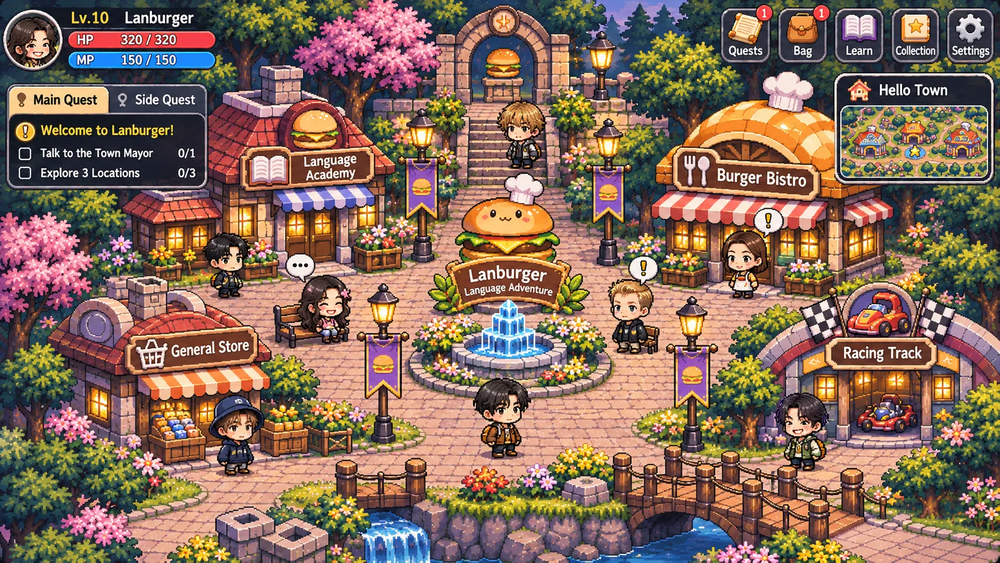
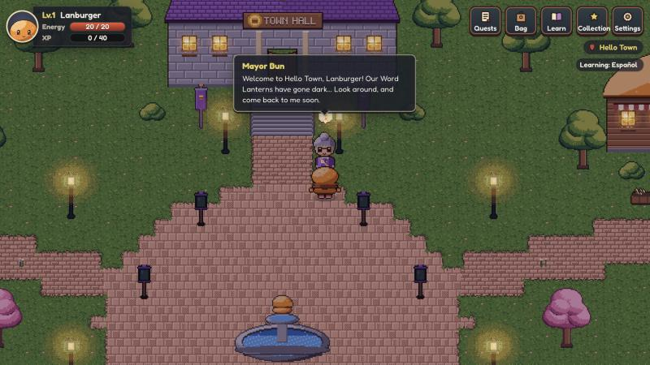

# R2 截圖與美術審核：美術垂直切片

拍攝日期：2026-11-05。來源：Claude App 內建瀏覽器。桌機 1280×720，手機橫向 812×375 加 `?touch=1`。

**線上就能看：**
- 美術展示頁（所有角色、動畫、配料、表情、建築）：https://jiahuichang.github.io/Lanburger/?gallery=1
- 預覽成長階段：https://jiahuichang.github.io/Lanburger/?stage=deluxe&toppings=lettuce,cheese,tomato,pickle,onion
  - 只是預覽，不會改到存檔。stage 可以填 `slider`、`classic`、`double`、`deluxe`。

## 跟參考圖並排

| 參考圖（`references/lanburger-town.png`） | 遊戲畫面（R2） |
| ---------------------------------------- | -------------- |
|  |  |

## 檔案

| 檔案 | 內容 |
| ---- | ---- |
| `desktop-01-mayor-bun-talk.jpg` | Mayor Bun 站在 Town Hall 石階前（頭上有 `!` 任務氣泡），轉向 Lanburger 說話 |
| `desktop-02-academy-sign.jpg` | Language Academy：英文招牌、窗戶暖光、花箱、草地蓋過石磚的邊緣、圓角路口 |
| `desktop-03-town-square.jpg` | 廣場、噴水池、Word Lanterns、路燈 |
| `desktop-04-garage-stream.jpg` | Racing Garage、會流動的溪水、土色河岸 |
| `desktop-05-growth-preview-double.jpg` | `?stage=double&toppings=…`：雙層漢堡加配料，站在有欄杆的木橋上 |
| `gallery-01-lanburger-stages.jpg` | 4 個成長階段 × 待機、四方向走路、說話、慶祝、答錯、學習 |
| `gallery-02-toppings-portraits.jpg` | 5 種配料（單獨和全部）、Deluxe 廚師帽、Lanburger 的 6 種表情 |
| `gallery-03-mayor-bun.jpg` | Mayor Bun：四方向走路、待機、說話 |
| `gallery-04-buildings.jpg` | 6 棟建築的招牌（像素字體） |
| `gallery-05-lanburger-portraits-large.jpg` | Lanburger 表情放大（平常、開心、驚訝、思考、擔心、慶祝） |
| `gallery-06-mayor-portraits.jpg` | Lanburger 角色圖和 Mayor Bun 的 6 種表情 |
| `mobile-01-mayor-talk.jpg` | 手機橫向：跟 Mayor Bun 說話 |

## R2 做了什麼

- **地圖過渡**：草地蓋過石磚和廣場邊緣，兩邊都是草的路口改成圓角。溪流有土色河岸和白色水花，森林邊緣是樹叢。木橋有欄杆，石階兩側有石牆。
- **會流動的水**：4 格動畫。Settings 開啟減少動態時會停止。
- **建築**：英文招牌（5×7 像素字體）、窗台花箱，每扇窗都有暖色光暈。
- **Lanburger 正式造型**：
  - 4 個成長階段：Slider、Classic、Double（雙層肉排）、Deluxe（加廚師帽）。
  - 5 種配料圖層：起司、番茄、酸黃瓜、洋蔥、生菜。配料跟身體分開畫，再疊在身上。
  - 動畫：四方向走路，還有說話、慶祝、答錯、學習（拿書）。
- **表情頭像**：Lanburger 和 Mayor Bun 都有 6 種，HUD 頭像也換成正式頭像。
- **範例 NPC Mayor Bun**：
  - 外型：銀髮綁包頭（名字由來）、圓眼鏡、紫色大衣、金色市長綬帶。
  - 在鎮上的行為：玩家靠近時會轉頭，頭上有 `!` 任務氣泡，可以按 Talk 對話。正式的對話系統在 R3。
- **共用的 Q 版人物繪製工具**（`src/art/painted/chibi.ts`）：每個 NPC 只要一張「角色設定卡」（髮型、髮色、膚色、服裝、配件），不用另外寫繪圖程式。朋友 NPC 也會用這個方式加入。

## 美術檢查（ART_DIRECTION §10）

- [x] 所有顏色都來自 `tokens.ts`，`src/` 裡沒有其他寫死的色碼。
- [x] 像素對齊網格。配料圖層和身體是同一個格子，不會錯位。
- [x] 黃昏中等亮度。窗戶和路燈是暖光，地圖整體疊了冷色調。
- [x] 角色 2–2.5 頭身，深色描邊。配料只在身體外圍加描邊，不會蓋到身體原本的線條。
- [x] UI 和招牌都是英文。
- [x] 文字最小 14px（招牌是像素字，屬於美術的一部分）。

## 請你審核的重點（這是 R2 的審核關卡）

1. **Lanburger 的造型和比例**：大小、表情、配料疊加的感覺。
2. **Mayor Bun 的畫風**：之後所有 NPC，包括朋友 NPC，都會照這個比例和細節程度畫。
3. **地圖的過渡和光線**：跟參考圖比，亮度、色調、細節密度是否接近你要的感覺。

## 已知落差

- 細節密度還不到參考圖（那張是 AI 生成的高解析圖）。建築和樹可以再加細節，但會增加製作時間。
- 廣場是用方格拼出來的，大範圍看邊緣還是有階梯感。圓角只修飾了每個轉角。
- Mayor Bun 側面時，眼鏡只看得到一邊，看起來有點擠。
- NPC 還不會走動，對話也只有一句。這些是 R3 的範圍。
